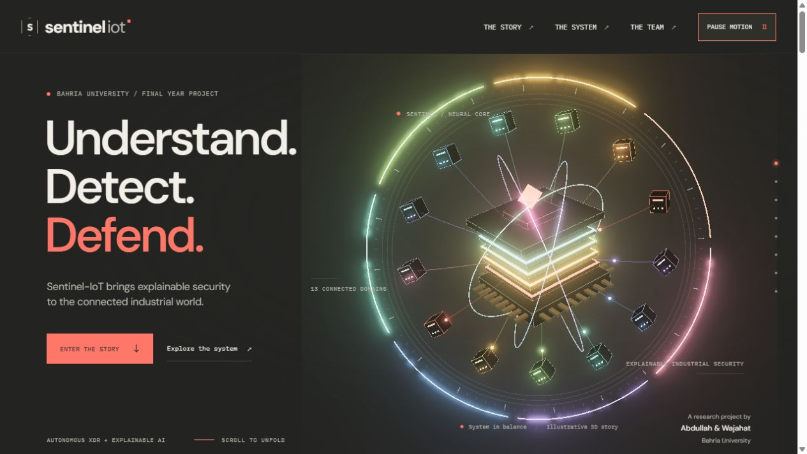
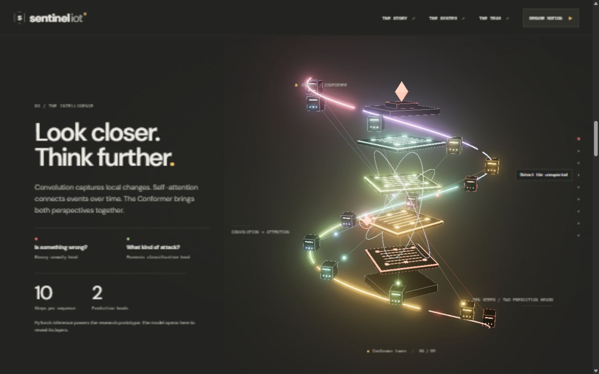
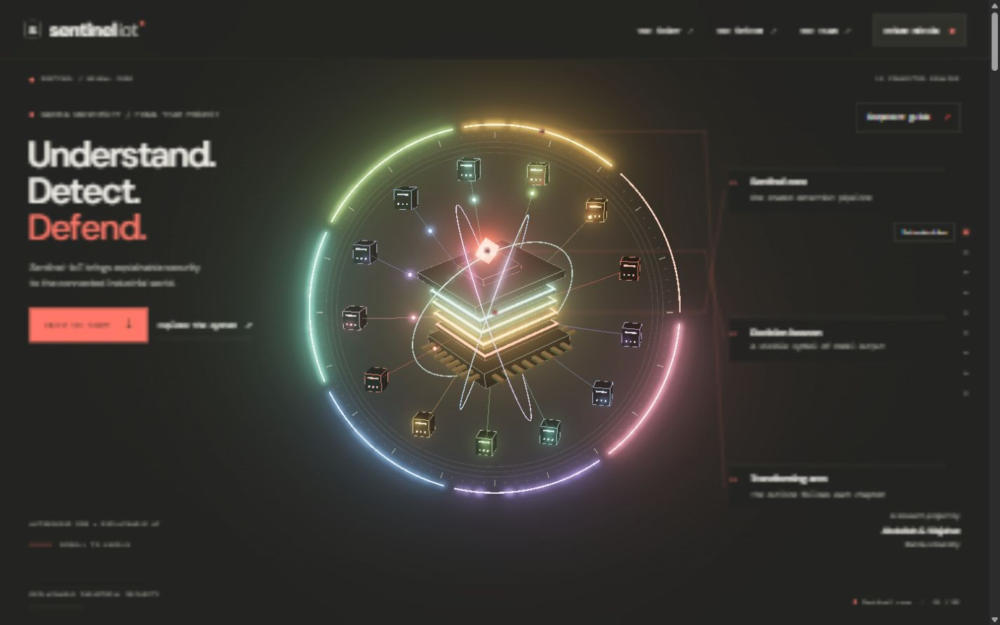
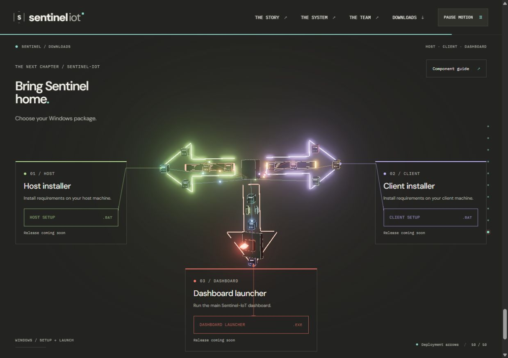
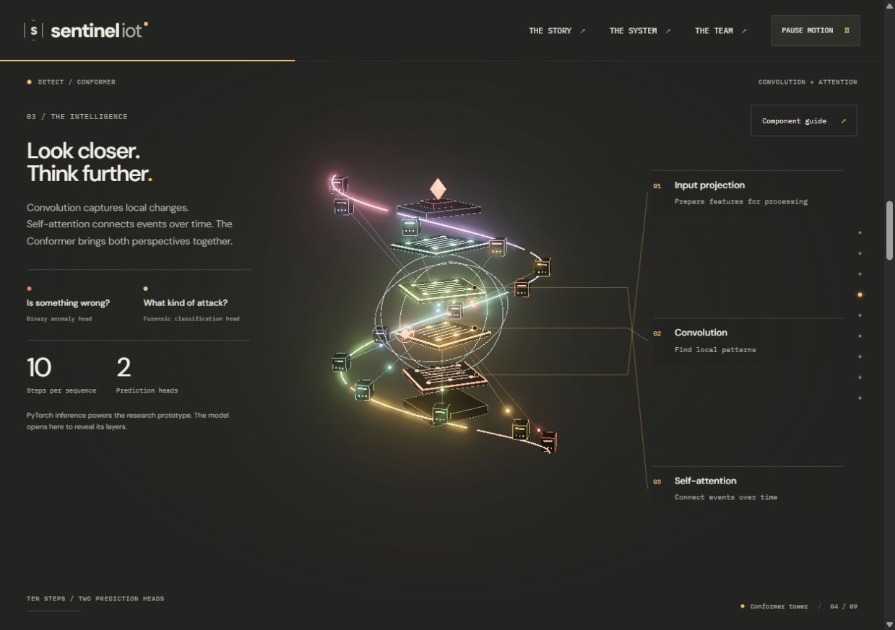
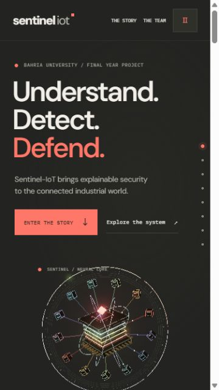
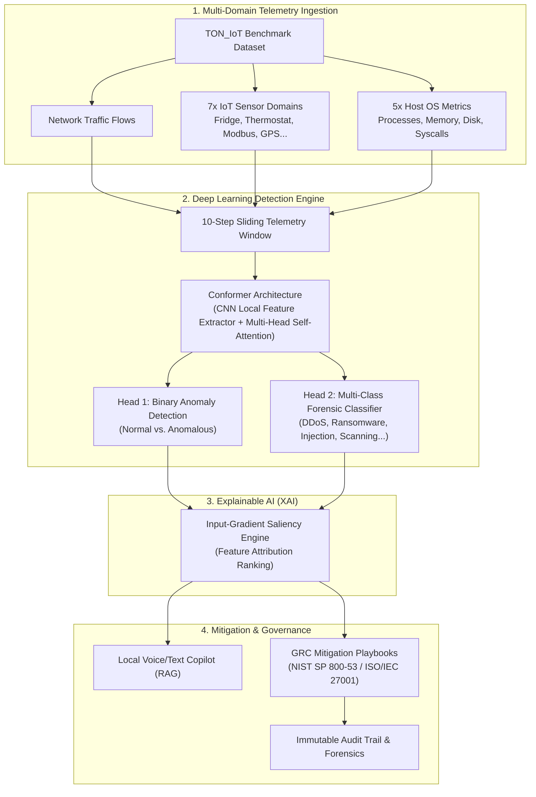

<div align="center">

# 🛡️ Sentinel-IoT Portfolio
### *Understand. Detect. Defend.*
**An Interactive 3D Web Experience & Research Showcase for Explainable Industrial IoT Security**

[](https://sentinelportfolio.vercel.app)
[](https://vitejs.dev/)
[](https://threejs.org/)
[](https://animejs.com/)
[](https://pytorch.org/)
[](https://fastapi.tiangolo.com/)
[](https://bahria.edu.pk/)
[](LICENSE)

<br />

### 🌐 [**View Live Deployment: sentinelportfolio.vercel.app**](https://sentinelportfolio.vercel.app)

<br />

<p align="center">
  
</p>

*An interactive, scroll-scrubbed 3D spatial presentation demonstrating the research and architecture behind Sentinel-IoT — an autonomous industrial Extended Detection & Response (XDR) platform powered by Conformer neural networks and Explainable AI (XAI).*

</div>

---

## 📖 Table of Contents

- [Overview](#-overview)
- [Key Interactive Features](#-key-interactive-features)
- [Visual Highlights](#-visual-highlights)
- [The 10-Chapter Story Journey](#-the-10-chapter-story-journey)
- [Core Security Architecture](#-core-security-architecture)
- [Tech Stack](#-tech-stack)
- [Project Structure](#-project-structure)
- [Getting Started](#-getting-started)
- [Research Artifacts & Publications](#-research-artifacts--publications)
- [The Team](#-the-team)
- [License & Acknowledgments](#-license--acknowledgments)

---

## 🌟 Overview

**Sentinel-IoT** is a Final Year Project developed at **Bahria University**, tackling the critical challenge of black-box security detection across complex Industrial Internet of Things (IIoT) infrastructures. 

This repository contains the **standalone interactive 3D portfolio and research demonstration platform**. Rather than a static landing page or traditional academic slide deck, the portfolio uses a bespoke **Three.js procedural 3D model** coupled with **Anime.js v4 timeline morphing** to translate dense telemetry concepts, Conformer neural network mechanics, and input-gradient saliency into an intuitive, tactile web narrative.

### Why It Matters
Modern industrial plants generate heterogeneous, multi-domain telemetry across network streams, host operating systems, and physical IoT sensors. Detecting zero-day anomalies is only half the battle — security engineers need **transparent, explainable evidence** before initiating physical device isolations. Sentinel-IoT bridges this gap through:
1. **Multi-Domain Sequence Modeling**: Unified detection across 13 industrial telemetry domains using the TON_IoT benchmark.
2. **Conformer Dual-Head Architecture**: Combining Convolution (local spatial anomaly extraction) with Multi-Head Self-Attention (temporal sequence awareness).
3. **Explainability by Design**: Real-time input-gradient saliency attribution for root-cause transparency.
4. **Human-in-the-Loop Orchestration**: Autonomous GRC playbooks aligned with NIST SP 800-53 and ISO/IEC 27001 with strict operator confirmation safeguards.

---

## ✨ Key Interactive Features

- 🌀 **Persistent Center-Stage 3D Model**: The 3D scene remains fixed in the viewport across the entire experience. It morphs procedurally between 10 states as the reader scrolls through chapters without ever reloading or breaking continuity.
- 📐 **Spatial Component Guide & Leader Lines**: Dynamic leader lines calculate 2D screen positions anchored directly to moving 3D components in real-time space, allowing users to inspect 30 individual architectural modules (sensors, memory pools, attention heads, containment barriers).
- 🔬 **Interactive 3D Model Lab (Modal Explorer)**:
  - Full orbital rotation (`Rotate Left`, `Rotate Right`)
  - **Layer Explosion Mode**: Disassemble the Conformer core into its four constituent processing tiers.
  - **Export for Blender (`.glb`)**: Download the live procedurally generated 3D model directly to disk for 3D modeling and rendering in Blender.
- 🚨 **Live Threat Demonstrations**:
  - **Replay Intrusion**: Recreate a telemetry anomaly burst and observe real-time spatial disruption.
  - **Demonstrate Containment**: Simulate autonomous playbook isolation and shield deployment.
- 🎨 **Adaptive Story Backgrounds**: Fluid full-screen color transitions matching narrative context (Teal for connected telemetry, Burgundy during breach, Violet during XAI saliency, Petrol during incident mitigation, Charcoal in neutral views).
- ♿ **Inclusive & Responsive Design**:
  - Dual layout engines: Narrow reading column for desktop displays; dedicated bottom reading pane for mobile devices to keep the 3D model unoccluded.
  - Full support for `prefers-reduced-motion` with instant story jumping and static poses.
  - Accessible fallback content when WebGL is unavailable.

---

## 📸 Visual Highlights

<div align="center">
  <table>
    <tr>
      <td width="50%" align="center">
        
        <br />
        <b>Chapter 03: Conformer Intelligence Tower</b>
      </td>
      <td width="50%" align="center">
        
        <br />
        <b>Chapter 05: Operator-Guided Containment Shield</b>
      </td>
    </tr>
    <tr>
      <td width="50%" align="center">
        
        <br />
        <b>Interactive 3D Component Inspector & Leader Lines</b>
      </td>
      <td width="50%" align="center">
        
        <br />
        <b>Chapter 09: Three-Way Deployment Hub</b>
      </td>
    </tr>
    <tr>
      <td width="50%" align="center">
        
        <br />
        <b>Scroll-Scrubbed Chapter Navigation</b>
      </td>
      <td width="50%" align="center">
        
        <br />
        <b>Mobile View with Centered 3D Viewport</b>
      </td>
    </tr>
  </table>
</div>

---

## 🗺️ The 10-Chapter Story Journey

| Scene | Chapter Title | 3D Model Transformation | Core Security Concept |
|:---:|:---|:---|:---|
| **00** | **Introduction** | Assembled Core | Neural core & industrial telemetry foundation |
| **01** | **A Connected World** | Connected Constellation | 13 telemetry domains (7 IoT sensors, 5 host OS, network) |
| **02** | **A Silent Intrusion** | Disrupted Spiral | Telemetry burst anomaly & early attack manifestation |
| **03** | **Detect the Unexpected** | Conformer Tower | Dual-head prediction: binary anomaly + forensic classifier |
| **04** | **Make it Explainable** | Feature Landscape | Input-gradient saliency attributions ranking influential inputs |
| **05** | **Respond with Control** | Containment Shield | Safe isolation playbooks with human-in-the-loop confirmation |
| **06** | **Keep the Evidence** | Evidence Folio | NIST SP 800-53 / ISO 27001 control mapping & forensic logs |
| **07** | **The System** | Connected Architecture | Full-stack pipeline (FastAPI, PyTorch, Next.js, Local Copilot) |
| **08** | **The Team** | Sentinel Signature | Researchers, academic supervisors & Bahria University |
| **09** | **Download Sentinel** | Three Deployment Arrows | Host Installer, Client Agent, and Dashboard Launcher |

---

## 🔬 Core Security Architecture



---

## 🛠️ Tech Stack

### Web Portfolio & 3D Interactive Layer
- **Engine**: [Vite 8.3](https://vitejs.dev/) (Native ESM development & bundling)
- **3D Graphics**: [Three.js r186](https://threejs.org/) (Procedural geometry, custom shaders, GLTF/GLB exporter)
- **Motion & Timelines**: [Anime.js v4](https://animejs.com/) (Scroll-scrubbing, mathematical morphing, staggered text reveals)
- **Styling & Typography**: Vanilla CSS with customized design tokens, glassmorphism, Google Fonts (*DM Sans* & *IBM Plex Mono*)
- **Accessibility**: Screen reader support, keyboard focus management, ARIA landmark roles, reduced motion query bindings

### Underlying Sentinel-IoT Research Platform
- **Machine Learning**: PyTorch, TorchScript, NumPy, Pandas, Scikit-learn
- **Backend API**: FastAPI, Uvicorn, WebSockets
- **Local Copilot**: Ollama / LLaMA 3 local inference, Sentence-Transformers, ChromaDB vector store
- **Voice Interface**: Whisper STT & Piper / Edge TTS local synthesis
- **Dataset**: University of New South Wales (UNSW) TON_IoT Industrial Dataset

---

## 📁 Project Structure

```text
sentinel_portfolio/
├── docs/                               # Screenshots, preview assets & verification manifests
│   ├── preview-desktop.jpg             # Desktop showcase preview
│   ├── preview-mobile.jpg              # Mobile layout preview
│   ├── preview-transform-tower.jpg     # Conformer tower transform screenshot
│   ├── preview-transform-shield.jpg    # Shield transform screenshot
│   ├── preview-component-labels-desktop.jpg
│   └── preview-downloads-desktop.jpg   # Deployment section preview
├── public/                             # Static public assets
│   ├── downloads/                      # Standalone installers & release metadata
│   ├── models/                         # 3D assets (sentinel-iot-core.glb)
│   ├── research/                       # Research papers (PDF manuscript & abstract)
│   │   ├── abstract.pdf
│   │   └── main_manuscript.pdf
│   └── favicon.svg                     # Vector brand icon
├── src/                                # Core portfolio application source
│   ├── center-stage.css                # 3D canvas stage framing & corner captions
│   ├── component-guide.css & .js       # 30-part component inspector & spatial leader lines
│   ├── components.js                   # Spatial telemetry & core component definitions
│   ├── downloads.css & .js             # Dynamic deployment arrow leaders
│   ├── main.js                         # Application lifecycle & event orchestration
│   ├── morphs.js                       # Mathematical 3D node transforms & light-arc curves
│   ├── project.js                      # Identity config, scene labels & environment options
│   ├── releases.js                     # Installer package URLs and metadata
│   ├── scene.js                        # Three.js procedural scene graph & camera controllers
│   ├── story-background.css & .js      # Contextual full-page dynamic gradient shifts
│   ├── story-motion.css                # Chapter progress bars & visited trail indicators
│   ├── story-scroll.js                 # Unified inertia wheel, touch & keyboard story navigation
│   ├── style.css                       # Global design system, typography & layouts
│   └── text-motion.js                  # Staggered 3D text reveals & word-wave decoders
├── index.html                          # Semantic HTML5 entry page with SEO metadata
├── package.json                        # Project dependencies and npm scripts
├── START_PORTFOLIO.bat                 # One-click Windows development launcher
└── vite.config.js                      # Vite development & build configuration
```

---

## 🚀 Getting Started

### Prerequisites
- [Node.js](https://nodejs.org/) version **20.0.0 or higher** (tested on Node 22 and 24)
- Modern web browser with WebGL 2.0 support (Chrome, Edge, Firefox, Safari)

### 1. Clone the Repository
```bash
git clone https://github.com/AbdullahHashmi663/sentinelIOT-portfolio.git
cd sentinelIOT-portfolio
```

### 2. Install Dependencies
```bash
npm install
```

### 3. Launch Development Server
```bash
npm run dev
```
Open your browser and navigate to **`http://127.0.0.1:4173`**.

### 4. One-Click Windows Launch
If you are running on Windows, double-click **`START_PORTFOLIO.bat`** in the repository root. The launcher will automatically verify dependencies, install them if necessary, and launch the portfolio server.

### 5. Build for Production
To generate an optimized production bundle:
```bash
npm run build
npm run preview
```
The compiled static assets will be output to the `dist/` directory.

---

## 📑 Research Artifacts & Publications

The research documents detailing the empirical validation of Sentinel-IoT are bundled directly within this repository under [`public/research/`](public/research/):

- 📄 **Full Academic Manuscript**: [`public/research/main_manuscript.pdf`](public/research/main_manuscript.pdf) — Comprehensive 25+ page thesis covering the industrial threat model, Conformer architecture, mathematical formulation of input-gradient saliency, and GRC mitigation mapping.
- 📋 **Executive Abstract**: [`public/research/abstract.pdf`](public/research/abstract.pdf) — High-level summary of the research methodology, TON_IoT benchmark evaluations, and findings.

---

## 👥 The Team

This project was conceived, designed, and engineered as a Final Year Project at **Bahria University, Islamabad**:

### Authors & Lead Researchers
- **Abdullah Bin Zubair Hashmi** — Deep Learning Architecture, Explainable AI, Full-Stack Development
- **Wajahat Ali Tariq** — Industrial IoT Telemetry Ingestion, GRC Mitigation & System Testing

### Academic Supervisors
- **Dr. Usman Hashmi** — Project Supervisor, Bahria University
- **Dr. Farman Ali** — Project Co-Supervisor, Bahria University

---

## 📄 License & Acknowledgments

- This project is open-source under the [MIT License](LICENSE).
- **Inspiration**: Visual flow and animation philosophy inspired by the craftsmanship of [Anime.js](https://animejs.com/).
- **3D Engine**: Powered by the open-source [Three.js](https://threejs.org/) community.
- **Dataset**: Research grounded in the TON_IoT dataset published by UNSW Canberra Cyber.

---

<div align="center">
  <sub>Built with passion for next-generation explainable cybersecurity. Bahria University Final Year Project.</sub>
</div>
